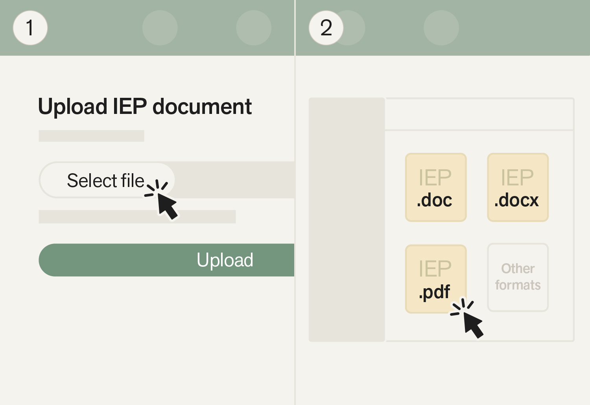
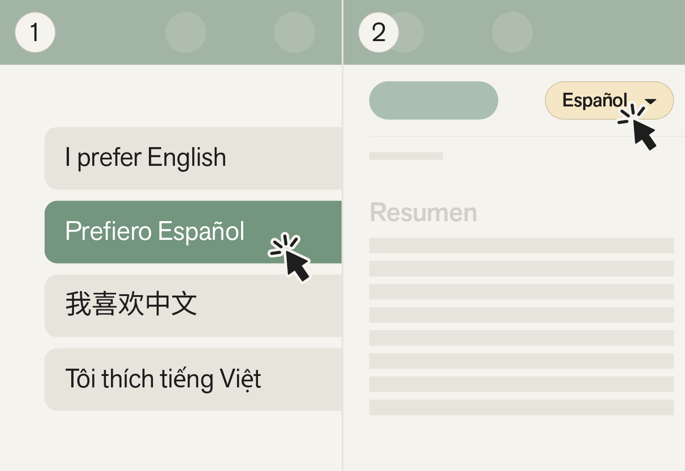
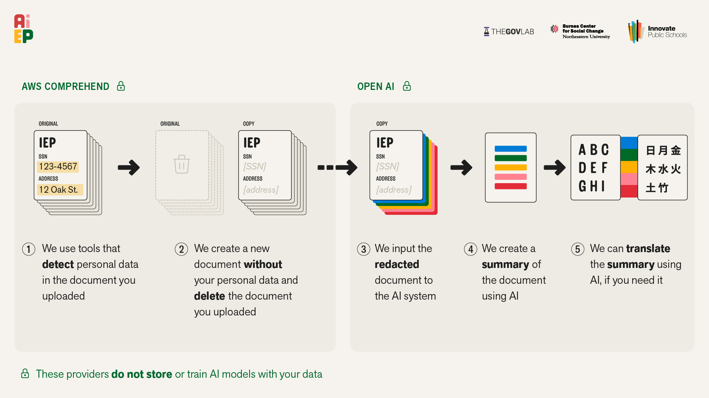
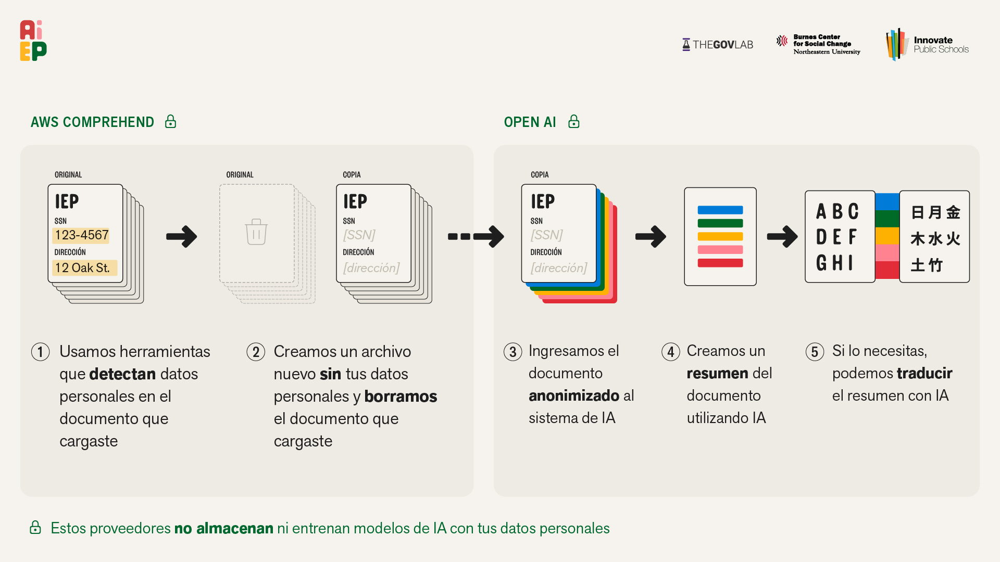

# A-IEP

[](https://github.com/The-Burnes-Center/a-iep/actions/workflows/ci.yml)
[](LICENSE)

**AI for Individualized Education Programs.** A-IEP helps parents understand their child's IEP. A parent uploads the IEP and gets back a plain-language summary, the key sections (services, accommodations, goals), and the meaning of every abbreviation. All of it is available in English, Spanish, Chinese or Vietnamese, with Arabic on the way.

**Live at [a-iep.org](https://a-iep.org/)**


[Watch the version with sound (MP4)](images/a-iep-launch.mp4)

---

## Contents

1. [What it does](#what-it-does)
2. [How it looks](#how-it-looks)
3. [Privacy and security](#privacy-and-security)
4. [How it works](#how-it-works)
5. [Getting started](#getting-started)
6. [Configuration](#configuration)
7. [Development and testing](#development-and-testing)
8. [Deployment](#deployment)
9. [Project structure](#project-structure)
10. [Technology](#technology)
11. [Contributing](#contributing)
12. [Getting help](#getting-help)
13. [Reporting a security issue](#reporting-a-security-issue)
14. [License](#license)

---

## What it does

**For a parent**

- **Upload an IEP** as a PDF or Word file, up to 50 MB, and follow its progress while it is read.
- **Read a summary** written for a parent, with the key sections and the page each one came from.
- **Look up any term or abbreviation** in a glossary built for IEPs.
- **Switch languages** at any time. A translation that has not been made yet is made on request.
- **Listen** to the summary read aloud (on staging; not yet live on a-iep.org).
- **Download a PDF** of the summary to share or print.
- **Replace an IEP** when a new one arrives. The old one is removed once the new one is ready.
- **Keep more than one child** on one account, each with their own documents.
- **Learn their rights** through guides to the IEP process and parent rights.
- **Delete everything** from the account center at any time.

**Built for the families who use it**

- **Every screen in English, Spanish, Chinese and Vietnamese.** Arabic, with a full right-to-left layout, is finished and on staging, and goes live on a-iep.org after review.
- **Sign-in in the parent's language.** The sign-in code arrives by text or email in the language chosen on the login screen.
- **No password to remember.** A parent signs in with a one-time code sent to their phone or email.
- **Works on a phone first**, since that is where most parents open it.

---

## How it looks

### Summary

A plain-language overview of the IEP.


### Key insights

Each insight opens to a fuller explanation.


### Glossary

Highlighted terms open a plain-language definition.


### Page references

Every section shows the pages it came from in the original IEP.


### Upload



### Language

Choose a language at the start, or change it from the summary.



---

## Privacy and security

IEPs describe children, so privacy shapes every part of A-IEP.



<details>
<summary>Ver en español (View in Spanish)</summary>



</details>

- **Personal details are removed before any AI sees the document.** AWS Comprehend finds names, addresses, phone numbers and similar details and removes them from the text. The student's name is replaced with a placeholder, which is put back only in the parent's own view.
- **The original file is deleted** as soon as its text has been read and cleaned. Only the cleaned text and the summaries made from it are kept.
- **Everything is encrypted**, in transit and at rest, with our own AWS KMS keys. Browsers are told to use HTTPS only (HSTS), and the site cannot be framed by another site.
- **Our AI providers do not train on this data.** OpenAI and Mistral do not use data sent through their APIs to train their models.
- **No passwords.** Parents sign in with a one-time code. A bot check (Cloudflare Turnstile) and strict sending limits stop anyone using the sign-in page to send texts in bulk.
- **Parents stay in control.** A parent can delete one document or the whole account. Deleting the account removes their documents and profile.
- **The results are a draft.** A-IEP helps a parent understand the IEP. It does not replace the document or the people who wrote it.

The source code is public. The data, the AWS accounts and the API keys are not: only the core team can reach them, and the keys live encrypted in AWS Parameter Store.

---

## How it works

A-IEP is serverless and runs on AWS, defined in code with the AWS CDK.

| Piece | What it does |
| --- | --- |
| **CloudFront and S3** | Serve the React app, with security headers and the standard `robots.txt`, `sitemap.xml` and `/.well-known/security.txt` (built per environment in `lib/user-interface/site-files.ts`) |
| **Cognito** | Accounts and passwordless sign-in through custom-auth triggers |
| **API Gateway (HTTP API)** | The app's API: sign-in, profiles, documents, translations, PDFs, audio |
| **Lambda** | All backend code, in Python 3.12 and Node.js 22 |
| **Step Functions** | Runs the document pipeline below |
| **DynamoDB** | Profiles, documents and processing state |
| **S3** | Uploads and processed results, encrypted with KMS |
| **SNS and SES** | Sign-in codes by text and by email |
| **CloudWatch** | Alarms, posted to Slack through AWS Chatbot |

### The document pipeline

When a parent uploads an IEP, a Step Functions state machine
(`lib/chatbot-api/state-machines/iep-processing.asl.json`) runs these steps.
The percentage is what the parent's progress bar shows.

1. **Start** (5%): record the document and its status.
2. **Read the text** (15%): Mistral OCR turns the file into text.
3. **Remove personal details** (20%): AWS Comprehend, plus the student-name placeholder.
4. **Delete the original** (22%).
5. **Analyze** (75%): an OpenAI model writes the summary and pulls out the sections and abbreviations.
6. **Translate** (97%): into the parent's language, if it is not English.
7. **Finish**: save the results, remove any IEP this one replaces, and remove the cleaned text the pipeline no longer needs.

Any failure records the reason and shows the parent a clear message. See
[`metadata-handler/README.md`](lib/chatbot-api/functions/metadata-handler/README.md)
for the full detail.

### Languages and right-to-left

- **Dictionaries:** the UI loads one JSON dictionary per language (`src/translations/*.json`) and prefetches the others while idle, so switching is instant.
- **Direction:** `src/common/direction.ts` swaps the Bootstrap LTR and RTL builds and keeps `<html dir>` and `<html lang>` in step, so an Arabic reader never sees a left-to-right flash.
- **Sign-in messages:** the sign-in texts and emails come from `lib/chatbot-api/functions/phone-otp-auth/messages.js`, in all five languages.
- **What each environment offers:** languages and optional features (such as audio) are switched on per environment by `ENABLED_LANGUAGES` and `enabledFeatures` in `lib/user-interface/index.ts`, so production and staging always run the same code.
- **PDFs:** downloaded PDFs use the document's language for headings and dates.

---

## Getting started

### What you need

- **Node.js 22**, which CI uses
- **Python 3.12**, for the Lambda tests
- **Docker**, running, for Lambda bundling
- **The AWS CLI**, signed in to the account you will deploy to
- **The AWS CDK CLI**: `npm install -g aws-cdk`
- **An OpenAI API key and a Mistral API key**

### Install

```bash
git clone https://github.com/The-Burnes-Center/a-iep.git
cd a-iep
npm ci
(cd lib/user-interface/app && npm ci)
(cd e2e && npm ci)
```

### First deploy to a new AWS account

1. Store the API keys and the other values in [Configuration](#configuration).
2. Bootstrap CDK once per account and region:
   ```bash
   cdk bootstrap aws://<ACCOUNT_ID>/<REGION>
   ```
3. Deploy (see [Deployment](#deployment) for how the shared environments are deployed):
   ```bash
   cdk deploy --all
   ```
   CDK runs the TypeScript directly and builds the React app itself, so there is
   no separate build step. Do not run `tsc` without `--noEmit` at the root: it
   writes `.js` files next to the sources, and the stray copies inside the app
   break its build.

---

## Configuration

Every secret lives in AWS Parameter Store. None are in this repository.
`<env>` is `prod` or `dev`; the staging stack deploys as `dev` (see
`getEnvironment()` in `lib/tags.ts`).

### Required

| Parameter | Type | Used for |
| --- | --- | --- |
| `/ai-iep/OPENAI_API_KEY` | SecureString | Analysis, translation, audio |
| `/ai-iep/MISTRAL_API_KEY` | SecureString | Reading the text of an IEP |
| `/a-iep/<env>/turnstile/site-key` | String | The sign-in bot check, in the browser |
| `/a-iep/<env>/turnstile/secret` | SecureString | The sign-in bot check, on the server |

```bash
aws ssm put-parameter --name "/ai-iep/OPENAI_API_KEY" --value "<key>" --type SecureString --overwrite
aws ssm put-parameter --name "/ai-iep/MISTRAL_API_KEY" --value "<key>" --type SecureString --overwrite
aws ssm put-parameter --name "/a-iep/<env>/turnstile/site-key" --value "<site-key>" --type String --overwrite
aws ssm put-parameter --name "/a-iep/<env>/turnstile/secret" --value "<secret>" --type SecureString --overwrite
```

### The sign-in bot check (Cloudflare Turnstile)

- **The two Turnstile values are a pair** from one widget in the Cloudflare dashboard. A site key from one widget and a secret from another fail every check, which looks like an outage.
- **Both environments use a real widget.** A check a script can pass is no check, so the end-to-end tests stub the widget in the browser and send a staging-only bypass token (`/a-iep/staging/e2e-turnstile-bypass`) that the server accepts only for the fictional 555-01XX test numbers. Production has no bypass.
- **Production also checks the site the check ran on** (`TURNSTILE_EXPECTED_HOSTNAMES` in `lib/authorization/new-auth.ts`). Serving A-IEP on a new domain means adding it there and in the Cloudflare widget, or sign-in on that domain is refused.
- **The check is invisible.** It runs only when a parent presses send, and it shows a challenge only if Cloudflare is unsure.
- **The secret is the on switch.** Without it, sign-in still works, but every request logs `TURNSTILE_NOT_CONFIGURED` and an alarm fires.
- **A local build with no site key loads no widget**, and the server treats that as switched off.

### Sign-in codes by text

The sign-in text ends with a line like `@a-iep.org #123456`. That is the
standard format (Apple, W3C and Google) that lets a phone offer the code only on
A-IEP's own site, so a fake site cannot collect it. Safari on iPhone and Mac
offers the code, and Android Chrome fills it in. The host comes from
`OTP_SMS_DOMAIN` in `lib/authorization/new-auth.ts`.

These optional parameters cap how many codes go out, and to where. The code
always uses whichever limit is **tighter**, so a missing or bad value narrows
sending rather than widening it. They can be changed during an incident without
a deploy.

```bash
aws ssm put-parameter --name "/a-iep/<env>/sms-policy/allowed-prefixes" --value "+1" --type String --overwrite
aws ssm put-parameter --name "/a-iep/<env>/sms-policy/max-per-hour" --value "50" --type String --overwrite
aws ssm put-parameter --name "/a-iep/<env>/sms-policy/max-per-day" --value "100" --type String --overwrite
```

### Optional

- **Audio:** `/a-iep/TTS_PROVIDER`, `/a-iep/TTS_VOICE_CONFIG` and `/a-iep/ELEVENLABS_API_KEY` choose the voice used to read summaries aloud.

---

## Development and testing

### Run the app locally

The app reads its settings from `/aws-exports.json`, which every deploy
publishes. Point a local copy at staging by saving staging's file into
`public/`:

```bash
cd lib/user-interface/app
curl -s https://dev.a-iep.org/aws-exports.json -o public/aws-exports.json
npm run dev
```

The file is gitignored. It holds staging's public client settings, not secrets,
but it changes with every deploy, so fetch it again if sign-in stops working.

### Tests

| Suite | Command | Where |
| --- | --- | --- |
| Infrastructure and Node Lambdas (Jest) | `npm test` | repo root |
| Python Lambdas (pytest) | `pip install -r test/python/requirements.txt` once, then `pytest` | repo root |
| Frontend (Vitest) | `npm test` | `lib/user-interface/app` |
| Frontend lint | `npm run lint` | `lib/user-interface/app` |
| Type checks | `npx tsc --noEmit` | repo root, and `lib/user-interface/app` |
| End-to-end (Playwright, against staging) | `npm test` | `e2e` |
| End-to-end, including the full document pipeline | `npm run test:pipeline` | `e2e` |

CI runs all of them except the end-to-end suites on every pull request. The
end-to-end suites run after every staging deploy and every night.

---

## Deployment

There are two environments, and git branches decide what goes where.

| Branch | Environment | URL | What happens on push |
| --- | --- | --- | --- |
| `staging` | Staging | [dev.a-iep.org](https://dev.a-iep.org) | Tests, deploy, smoke test, end-to-end tests |
| `main` | Production | [a-iep.org](https://a-iep.org) | Tests, deploy, smoke test |

- **Changes reach production only through a pull request** from staging to `main`, once they have passed on staging.
- **Do not run `cdk deploy` against the shared environments by hand.** GitHub Actions deploys them.
- **Health checks:** a GitHub Actions job checks sign-in every 15 minutes. A nightly job checks both environments for leftover files.
- **Alarms:** CloudWatch alarms post to Slack. [`docs/RUNBOOK.md`](docs/RUNBOOK.md) says what each one means and what to do.

---

## Project structure

```
a-iep/
├── bin/                         CDK entry point
├── lib/
│   ├── authorization/           Cognito and passwordless sign-in
│   ├── chatbot-api/
│   │   ├── functions/           Every Lambda
│   │   │   ├── metadata-handler/       The document pipeline
│   │   │   ├── phone-otp-auth/         Sign-in codes by text and email
│   │   │   ├── user-profile-handler/   Profiles, children, documents
│   │   │   ├── translation-request-handler/  Translations on request
│   │   │   ├── pdf-generator/          PDF downloads
│   │   │   ├── tts-handler/            Audio summaries
│   │   │   └── ...                     Alerts, referrals, email and SMS delivery
│   │   ├── state-machines/      Step Functions definitions
│   │   ├── gateway/             API Gateway
│   │   ├── monitoring/          CloudWatch alarms and Slack alerts
│   │   ├── buckets/             S3
│   │   ├── tables/              DynamoDB
│   │   └── email/               SES
│   ├── user-interface/app/      The React app
│   └── shared/                  Shared helpers
├── test/                        Jest and pytest suites
├── e2e/                         Playwright end-to-end tests
├── scripts/                     Smoke test and maintenance scripts
├── docs/                        Runbook, plans and research
└── images/                      Pictures used in this README
```

---

## Technology

- **Infrastructure:** AWS CDK (TypeScript), Lambda, Step Functions, API Gateway, Cognito, DynamoDB, S3, CloudFront, KMS, SNS, SES, Comprehend, CloudWatch
- **Backend:** Python 3.12 and Node.js 22 Lambdas
- **AI:** OpenAI for analysis, translation and audio; Mistral OCR for reading documents
- **Frontend:** React 18, TypeScript, Vite, React Router, AWS Amplify, Bootstrap 5 (LTR and RTL)
- **Testing:** Jest, pytest, Vitest, Playwright

---

## Contributing

1. **Branch from `staging`.**
2. **Make your change** in the style of the code around it, with tests.
3. **Run the tests** in [Development and testing](#development-and-testing).
4. **Open a pull request into `staging`**, with [conventional commit](https://www.conventionalcommits.org/) messages (`feat:`, `fix:`, `docs:` and so on).

Never put a parent's or child's details in code, tests, logs or issues.

---

## Getting help

- **Families:** use the Support Center inside the app at [a-iep.org](https://a-iep.org/).
- **Developers:** open an [issue](https://github.com/The-Burnes-Center/a-iep/issues). Never paste a real IEP or a family's details into one.
- **Maintainers:** A-IEP is built and run by [The Burnes Center for Social Change](https://burnes.northeastern.edu/) at Northeastern University.

---

## Reporting a security issue

Please do not open a public issue. Report it privately through
[GitHub's vulnerability reporting](https://github.com/The-Burnes-Center/a-iep/security/advisories/new).
See [SECURITY.md](SECURITY.md) for what to include and what happens next.

---

## License

[Creative Commons Attribution-NonCommercial 4.0 International](https://creativecommons.org/licenses/by-nc/4.0/deed.en). You may share and adapt this work for non-commercial purposes if you give credit. See [LICENSE](LICENSE).

© 2025 The Burnes Center for Social Change.
